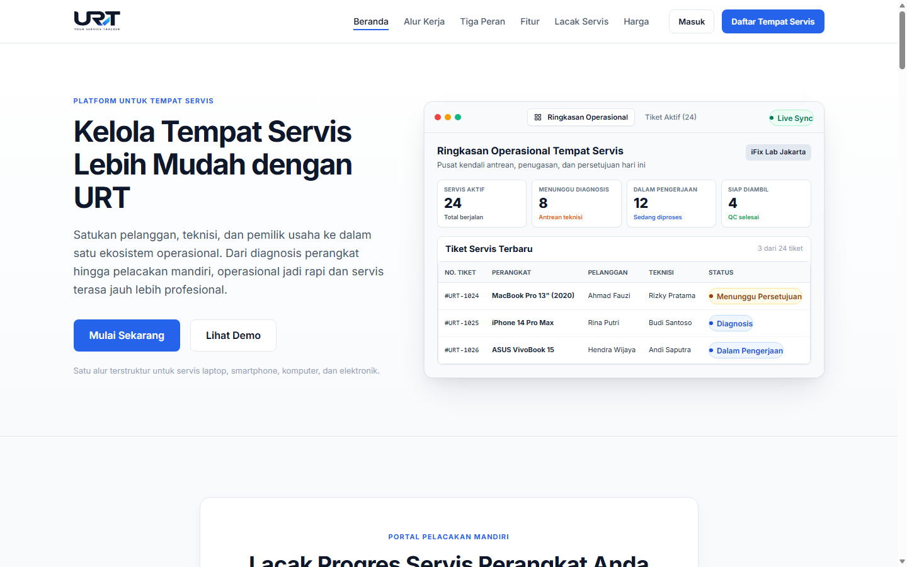
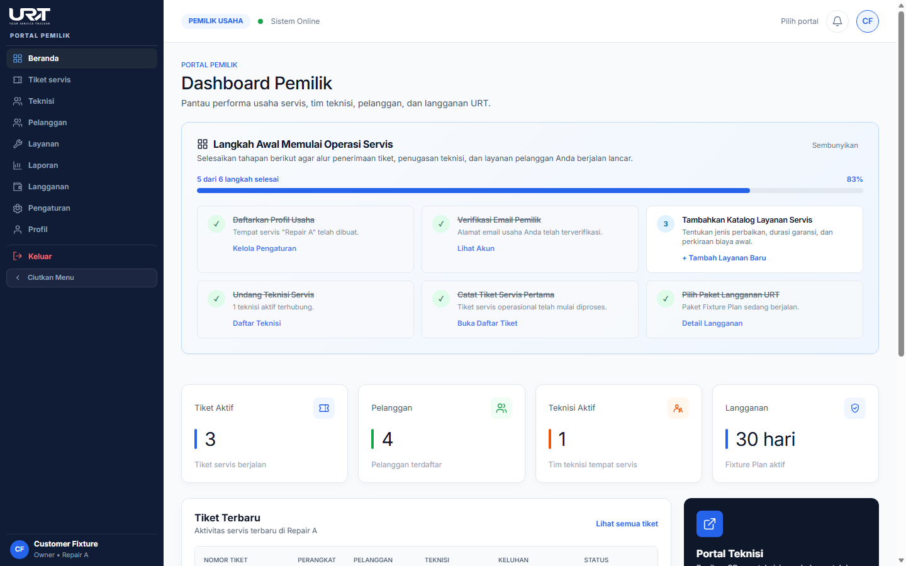
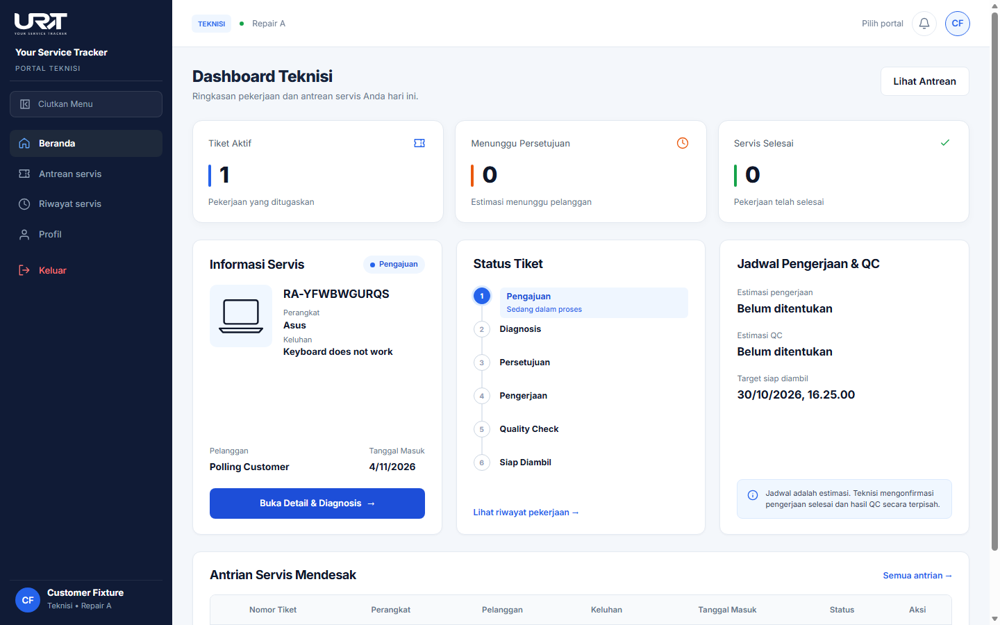
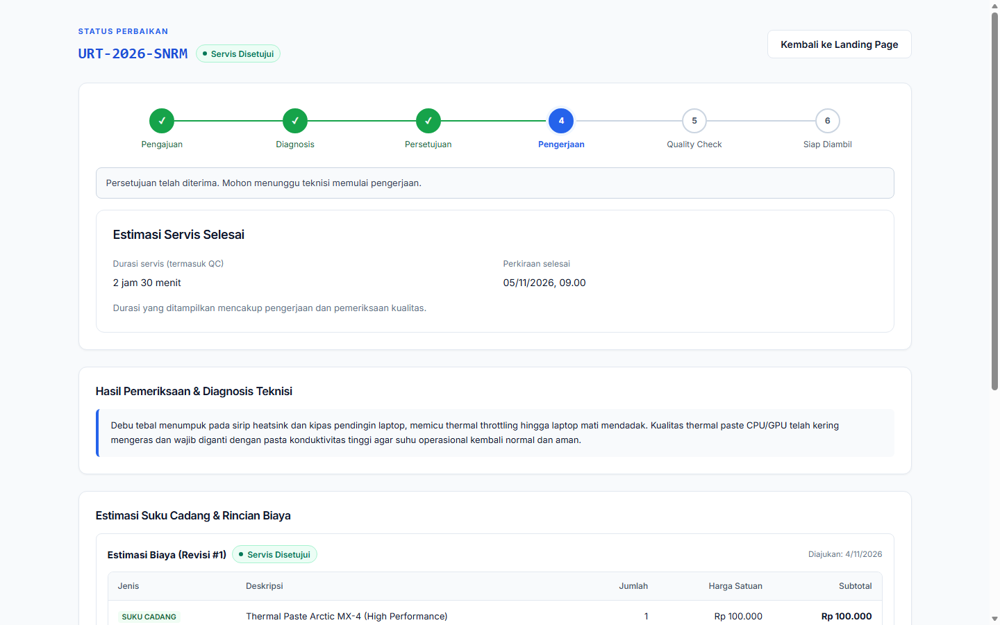
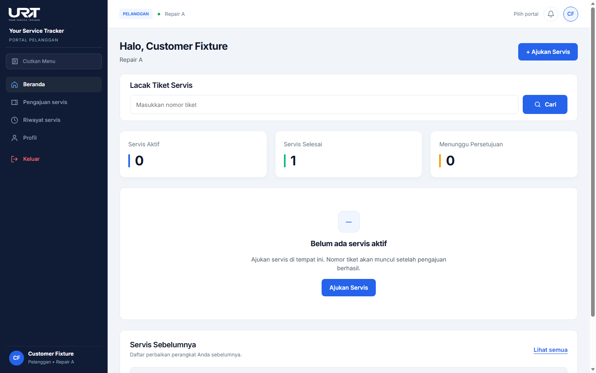
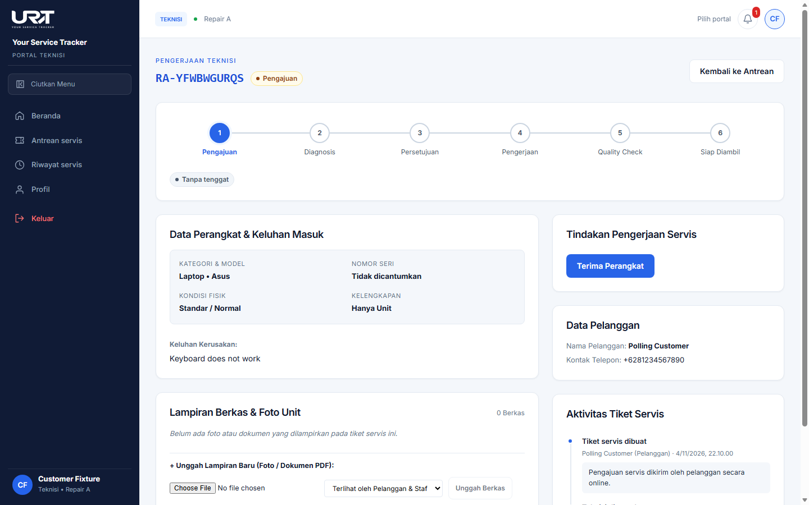
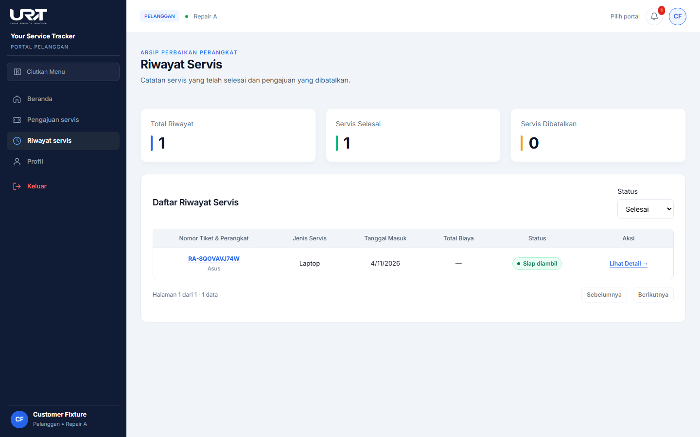
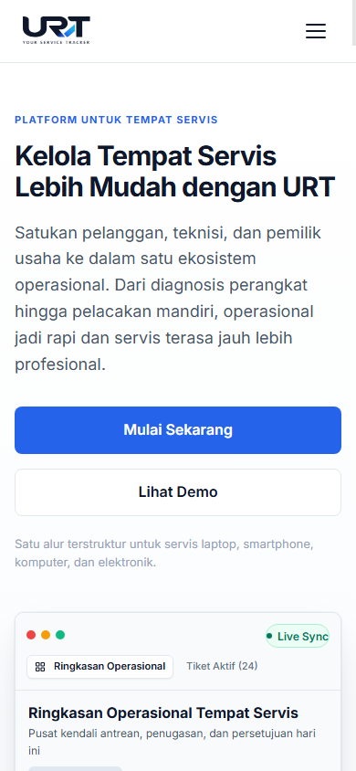
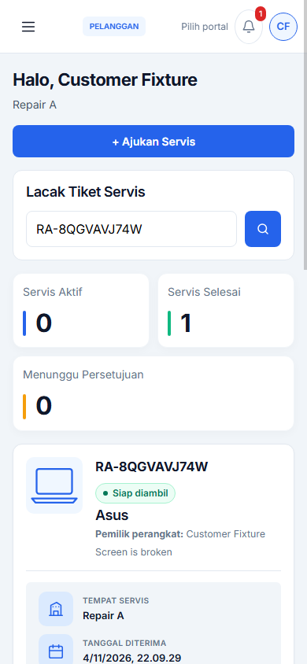

# URT - Your Service Tracker

URT is a service-management platform for repair shops. It helps an owner, technicians, and customers follow the same repair from intake through diagnosis, estimate approval, repair, quality check, and handover.

The repository contains two generations of the interface:

- **Current application:** a React and TypeScript single-page app in `urt/web`, backed by an Express and TypeScript API in `urt/api`.
- **Earlier prototype:** static HTML, CSS, and JavaScript pages in the repository root and the `owner/`, `teknisi/`, and `pelanggan/` folders. These are visual/product references; the current portal is the `urt/` application.

For a beginner-friendly visual walkthrough and technical summary, see the [URT Project Overview PDF](URT_Project_Overview.pdf).

## What URT does

### Owner

- Review business activity, tickets, customer records, technician assignments, and service catalog.
- Create walk-in service tickets and manage ticket intake.
- Review invoices, record payments, and view operational reports.

### Technician

- See assigned work and open ticket details.
- Record diagnosis and prepare a versioned estimate.
- Update repair progress and quality-check results.

### Customer

- Submit a service request and follow a repair.
- Review the diagnosis and estimate, then approve or reject it.
- View service history and handover information.

## Repair flow

```text
Request or walk-in
        -> Owner intake and technician assignment
        -> Technician diagnosis and estimate
        -> Customer approval or rejection
        -> Repair and quality check
        -> Ready for pickup, invoice, and owner-confirmed handover
```

Ticket changes are handled through specific API operations, with status, estimate revision, approval, and timeline data stored with the ticket. This helps keep each role's view aligned with the persisted service record.

## Technology overview

| Layer | Technology | Purpose |
| --- | --- | --- |
| Current web app | React 19, TypeScript, Vite | Single-page interface for the public pages and three role portals |
| Routing and state | React Router, Redux Toolkit, RTK Query | Page navigation, shared session state, API requests, and cache updates |
| Styling | CSS, CSS Modules, CSS custom properties | Responsive layouts and shared visual tokens |
| API | Node.js, Express 4, TypeScript | Versioned REST endpoints under `/api/v1` |
| Main database | MongoDB with Mongoose | Businesses, accounts, customers, technicians, tickets, services, invoices, and file metadata |
| Session support | Redis | Short-lived session and authentication-related state |
| Optional file storage | Cloudflare R2 via the AWS S3 SDK | Private file objects and expiring signed download links |
| Optional email | SMTP via Nodemailer | Verification, recovery, and service messages when configured |
| Optional identity provider | Google Identity Services | Google sign-in when configured |

The root-level prototype uses HTML, CSS, and JavaScript. It is separate from the current React portal and should not be confused with the API-backed application.

## Architecture at a glance

```text
Browser (React SPA)
  |  HTTPS/JSON requests to /api/v1
  v
Express API (feature modules, validation, role/business access checks)
  |-- MongoDB / Mongoose: durable business records
  |-- Redis: session and short-lived authentication state
  |-- R2: private upload objects (optional configuration)
  |-- SMTP and Google sign-in (optional configuration)
```

The API is organized by product area: authentication, business, ticket, customer, technician, service catalog, invoice, report, subscription, upload, and user. Business records are scoped to a business; membership and role checks control access to each portal.

### API examples

All routes below are relative to `/api/v1`:

- `GET /businesses/{businessId}/tickets` - list tickets visible to the signed-in business role.
- `POST /businesses/{businessId}/tickets` - submit a service request or record an intake, subject to role and request validation.
- `POST /businesses/{businessId}/tickets/{ticketId}/estimates` - submit an estimate for customer review.
- `POST /businesses/{businessId}/tickets/{ticketId}/approval` - record the customer's estimate decision.
- `GET /public/businesses/{slug}` - read public business information.
- `POST /public/tracking` - request a limited public tracking view using the required lookup details.

The browser client uses RTK Query and sends credentials and the required authorization/CSRF information through a shared API base query.

## Data and integrations

- **MongoDB** is the source of truth for persistent application records. The current database connection selects `urt_demo`; set a dedicated database and valid connection URI for local/demo use.
- **Redis** is a supporting service for sessions and short-lived authentication state, not the business-record database.
- **R2, SMTP, and Google sign-in are optional integrations.** Their credentials and enablement belong in local environment configuration or deployment secrets. The app can expose configuration-dependent behavior when they are unavailable.
- Actual production readiness depends on configuring these services, frontend origin/cookies, security keys, and a MongoDB/Redis deployment appropriate for the environment.

## Project structure

```text
.
|-- index.html, owner/, teknisi/, pelanggan/   # Earlier static prototype
|-- css/, js/, image/                          # Prototype styles, scripts, and logo
|-- assets/screenshots/                        # Product showcase screenshots
|-- urt/
|   |-- web/                                    # Current React + TypeScript app
|   |   `-- src/features/                       # Public, owner, technician, customer, tickets, etc.
|   `-- api/                                    # Current Express + TypeScript API
|       |-- src/modules/                        # API feature modules
|       |-- src/models/                         # Mongoose models
|       `-- tests/                              # API workflow and behavior tests
|-- prd.md                                      # Product requirements and UI guidance
|-- DATA_SOURCES.md                             # Current data-source and API notes
`-- urt/*_IMPLEMENTATION_PLAN.md                # Implementation notes and history
```

## Run locally

Prerequisites: Node.js 20 or newer, MongoDB, and Redis. The API validates required environment settings at startup. Create `urt/api/.env` with the required database, Redis, signing-key, and allowed-origin settings described in `urt/api/src/core/config/index.ts`. Keep secrets out of source control. R2, SMTP, and Google settings are only needed for the corresponding integrations.

Start the API in one terminal:

```bash
cd urt/api
npm install
npm run dev
```

Start the web app in another terminal:

```bash
cd urt/web
npm install
npm run dev
```

Vite serves the web app at `http://localhost:5173` and proxies `/api` to `http://127.0.0.1:5000` in development. Configure `VITE_API_BASE_URL` in `urt/web/.env` if using a different API URL. A production frontend build is created with `npm run build` from `urt/web`; the API build uses `npm run build` from `urt/api`.

## Screenshots

These screenshots were captured from the current React application in a local browser. Portal screens use isolated demonstration records; the images show the real application UI, not mockups.

### Public landing page



### Owner dashboard



### Technician dashboard



### Customer service tracking



### Customer portal



### Ticket details



### Service history



### Mobile responsive views





## Known caveats and project follow-up

- Some repository documents describe different points in the migration from the static prototype to the React/API app. This README and `DATA_SOURCES.md` describe the current `urt/` code; older prototype descriptions and historical plan observations should be read in context.
- The current database configuration selects `urt_demo`. Confirm this points to an isolated demo database before running against any important MongoDB deployment.
- Optional services (R2, SMTP, Google sign-in) require valid provider configuration and have not been verified simply by reading the source tree.
- A source review cannot confirm that the full application starts correctly with a particular `.env`, database, Redis server, or provider account. Run the app in the intended environment and complete role-by-role acceptance walkthroughs before presenting or deploying it.
- Subscription/payment screens should be presented according to their actual configured/demo behavior. The repository contains subscription and payment-related code, but this overview does not claim that a live payment gateway is connected.

## Product purpose

URT is designed to reduce scattered paper notes and chat-based follow-ups by giving the owner, technician, and customer a shared service record with clear progress, approval, and handover steps. See [`prd.md`](prd.md) for product requirements and [`DATA_SOURCES.md`](DATA_SOURCES.md) for current data and API details.

## Team contributors

Contributor names and areas below are summarized from the Git commit authors and commit messages available in this repository. A person may appear under more than one Git author alias.

| Contributor | Contributions reflected in commit history |
| --- | --- |
| **Nurul Faiziah M.** | Current React/API application work, migration and integration, service workflow, authentication and security, dashboards/reports, deployment configuration, documentation, and product presentation. |
| **Sofia** | Earlier customer-facing prototype and PHP/MySQL-era work, including customer portal interactions, registration/login work, service-tracking logic, and SQL updates. |
| **Nino R.** | Prototype portal styling and interaction work, including owner/customer/technician screens, CRUD-style flows, and service request/approval UI. |
| **Wildan Krisna Hakim** | Initial project assets and files added to the repository. |

This is a commit-history summary, not a claim that every contribution is fully represented by Git author metadata. The current application has evolved substantially from the early prototype.

### Contribution Details

**Nurul Faiziah M. — October 26–November 4, 2026**

- Improved Owner, Technician, and Customer portals with responsive layouts, ticket tracking, service history, notifications, and QR-based portal sharing.
- Expanded the service workflow across intake, diagnosis, estimates, customer approval, repair, quality checks, and handover.
- Updated operational reports with completed-service revenue calculations and monthly revenue comparisons.
- Strengthened authentication and security with rate limits, CSRF checks, and safer session, signing-key, and proxy configuration.
- Fixed deployment configuration and VPS Docker/Compose workflows for the web app and API.
