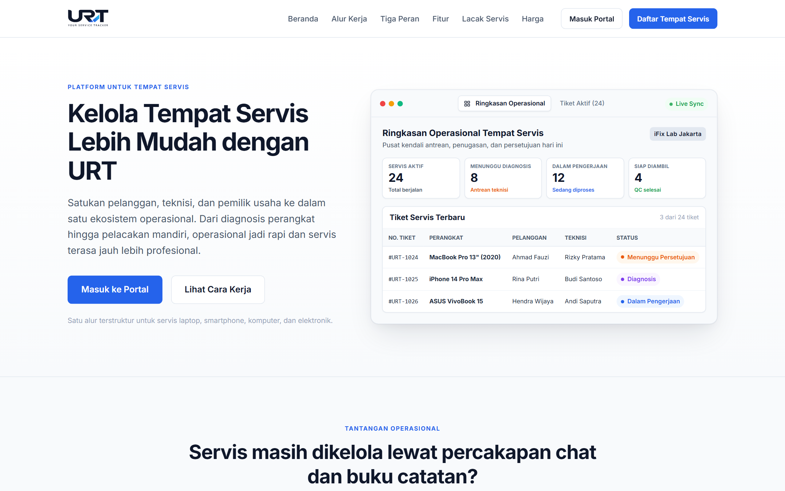
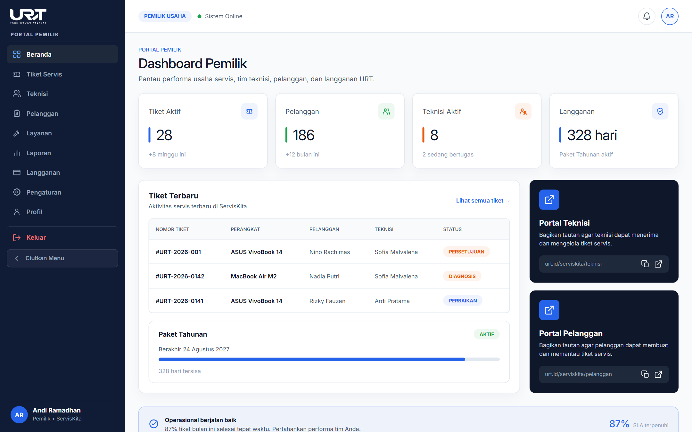
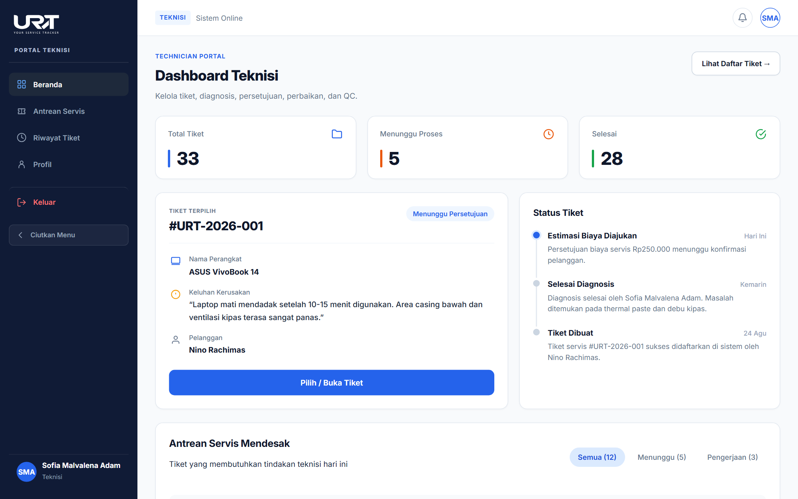
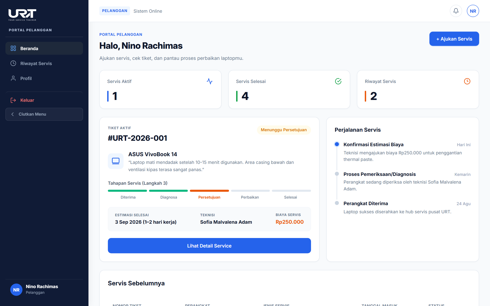
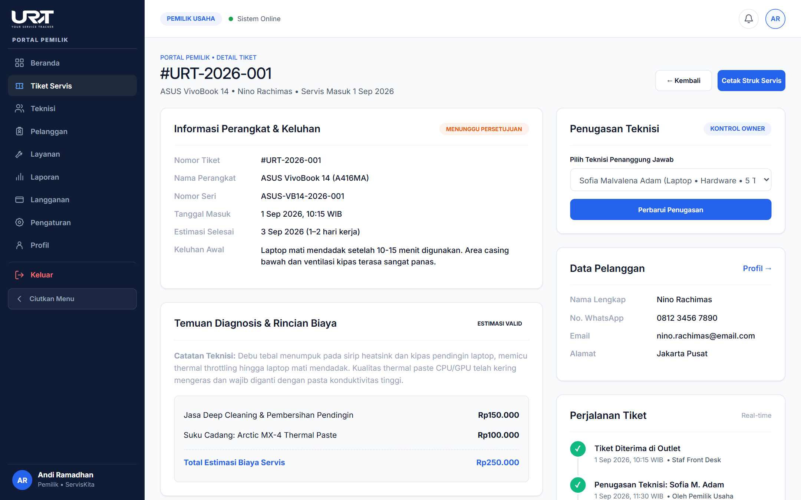
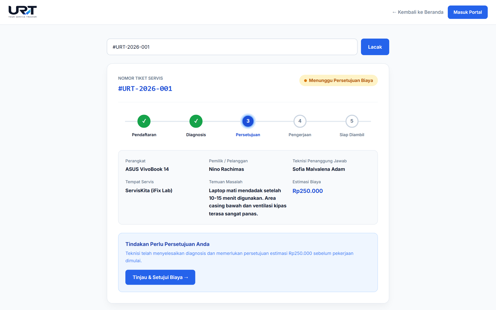
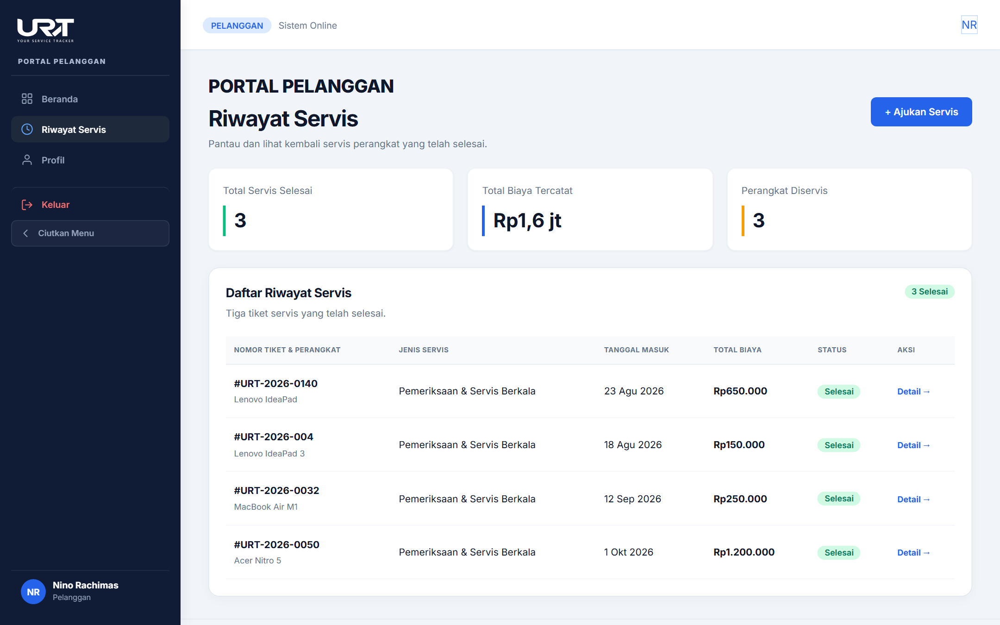
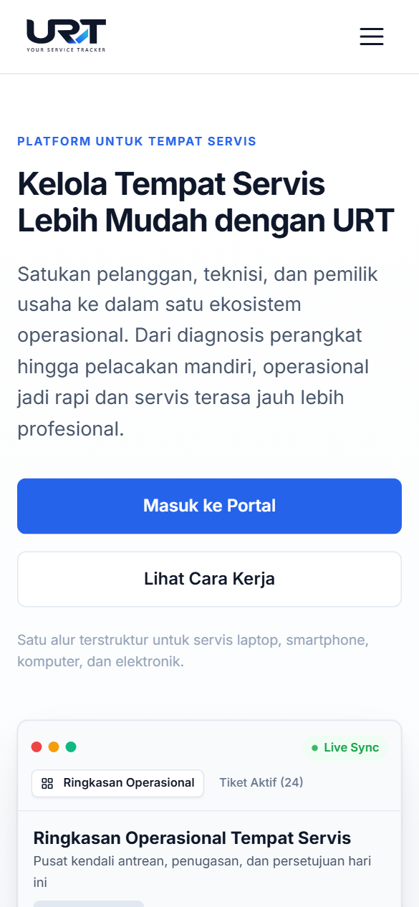

# URT — Your Service Tracker

<p align="center">
  
</p>

<p align="center">
  <strong>A service tracking and management platform designed to help Tempat Servis manage service tickets, repair progress, customer communication, and service information in a more organized way.</strong>
</p>

<p align="center">
  
  
  
  
  
  
</p>

---

## Table of Contents

- [About the Project](#about-the-project)
- [Problem Background](#problem-background)
- [Project Goals](#project-goals)
- [Key Features](#key-features)
  - [Owner (Pemilik Usaha)](#owner-pemilik-usaha)
  - [Teknisi (Technician)](#teknisi-technician)
  - [Pelanggan (Customer)](#pelanggan-customer)
- [Application Workflow](#application-workflow)
- [Application Preview](#application-preview)
  - [Landing Page](#landing-page)
  - [Owner Portal](#owner-portal)
  - [Teknisi Portal](#teknisi-portal)
  - [Pelanggan Portal](#pelanggan-portal)
  - [Ticket Detail](#ticket-detail)
  - [Service Tracking](#service-tracking)
  - [Service History](#service-history)
  - [Mobile Responsive View](#mobile-responsive-view)
- [Technology Stack](#technology-stack)
- [Project Structure](#project-structure)
- [How to Run](#how-to-run)
- [Figma Design — Modul 5](#figma-design--modul-5)
- [Team Contributions](#team-contributions)
  - [Contribution Details](#contribution-details)
  - [Contribution Note](#contribution-note)
- [AI-Assisted Development](#ai-assisted-development)
- [Prompt Log & Manual Improvements](#prompt-log--manual-improvements)
- [Git Workflow](#git-workflow)
- [Project Status](#project-status)
- [Team](#team)

---

## About the Project

**URT — Your Service Tracker** adalah platform pelacakan dan manajemen operasional servis yang dirancang khusus untuk kebutuhan **Tempat Servis** (seperti tempat servis laptop, smartphone, komputer, dan perangkat elektronik lainnya).

Sistem ini mengintegrasikan tiga pemangku kepentingan utama—**Owner**, **Teknisi**, dan **Pelanggan**—ke dalam satu ekosistem digital yang terkoordinasi. Dengan URT, pelanggan dapat memantau proses perbaikan perangkat secara transparan dan mandiri, sementara teknisi dan pemilik usaha dapat mengelola antrean pengerjaan, diagnosis kerusakan, persetujuan biaya, hingga pelaporan transaksi secara terpusat.

---

## Problem Background

Banyak usaha Tempat Servis skala kecil dan menengah masih mengandalkan alur kerja manual:
- **Pencatatan Fisik & Tercecer:** Nota kertas dan buku manual rawan hilang, rusak, atau terselip.
- **Komunikasi Terfragmentasi:** Percakapan pembaruan status dan biaya via chat WhatsApp sering kali tenggelam, membingungkan pelanggan, dan memicu salah paham.
- **Konfirmasi Biaya yang Terhambat:** Pelanggan lambat memberikan kepastian perbaikan karena tidak adanya rincian diagnosis dan estimasi biaya yang terdokumentasi rapi.
- **Visibilitas Operasional Rendah:** Pemilik usaha kesulitan memantau beban kerja teknisi harian, status setiap unit yang sedang dikerjakan, serta performa pendapatan secara *real-time*.

URT hadir untuk mentransformasikan alur kerja tradisional tersebut menjadi alur operasional digital yang terstruktur, rapi, dan profesional.

---

## Project Goals

1. **Memudahkan Pelacakan Servis Mandiri:** Memberikan pelanggan akses langsung untuk mengetahui tahapan perbaikan perangkat mereka kapan saja tanpa perlu berulang kali menghubungi pihak Tempat Servis.
2. **Membantu Teknisi Mengelola Tiket:** Menyediakan ruang kerja digital terstruktur bagi teknisi untuk mencatat temuan diagnosis, kebutuhan suku cadang, dan estimasi waktu kerja.
3. **Merapikan Informasi Diagnosis & Estimasi Biaya:** Menghadirkan rincian biaya yang transparan serta alur persetujuan (*approval*) biaya sebelum tindakan perbaikan dimulai.
4. **Meningkatkan Komunikasi Tempat Servis & Pelanggan:** Menyediakan pembaruan status yang konsisten dan pesan notifikasi terstruktur antara teknisi dan pemilik perangkat.
5. **Membantu Pemilik Usaha Memantau Operasional:** Memberikan visibilitas terpadu kepada Owner terkait tiket aktif, performa teknisi, database pelanggan, dan laporan berkala.
6. **Mengurangi Ketergantungan Alur Manual:** Mengurangi miskomunikasi dan hilangnya data akibat pencatatan terfragmentasi di berbagai media chat atau catatan fisik.

---

## Key Features

Fitur-fitur URT diorganisasikan berdasarkan tiga peran utama:

### Owner (Pemilik Usaha)
Pusat kendali operasional Tempat Servis untuk memantau performa bisnis dan pengelolaan tim:
- **Dashboard Operasional:** Ringkasan metrik utama mencakup tiket aktif, total pelanggan, jumlah teknisi aktif bertugas, dan status paket langganan.
- **Manajemen Tiket Servis:** Daftar tiket servis komprehensif dilengkapi filter status (*Menunggu Diagnosis*, *Persetujuan*, *Pengerjaan*, *Selesai*), pencarian ID tiket, dan aksi cetak struk servis.
- **Manajemen Teknisi:** Pengelolaan data staf teknisi, penugasan tiket, pemantauan beban kerja harian, keahlian/spesialisasi perangkat, serta penambahan dan pengeditan profil teknisi.
- **Manajemen Pelanggan:** Database kontak pelanggan terpadu (nama, nomor WhatsApp, email, alamat), rekam jejak riwayat servis perangkat, formulir tambah pelanggan baru, serta antarmuka import data pelanggan.
- **Katalog Layanan & Tarif:** Pengaturan daftar jenis layanan servis (jasa perbaikan dan suku cadang), tarif dasar, dan estimasi durasi pengerjaan.
- **Laporan Operasional:** Visualisasi data pendapatan, tingkat penyelesaian servis tepat waktu (*SLA fulfillment*), dan tren volume servis bulanan.
- **Manajemen Langganan URT:** Informasi paket langganan aktif Tempat Servis, opsi perpanjangan paket, petunjuk pembayaran QRIS/Virtual Account, dan riwayat faktur (*invoice*).
- **Pengaturan Usaha & Profil:** Konfigurasi identitas Tempat Servis, alamat cabang, jam operasional, dan pengaturan akun pemilik usaha.

### Teknisi (Technician)
Lingkungan kerja praktis untuk menangani unit perangkat masuk dari diagnosis hingga pengujian:
- **Dashboard Teknisi:** Ringkasan harian tiket penugasan pribadi, status tiket menunggu proses, unit selesai, dan kartu informasi tiket terpilih.
- **Antrean Servis:** Pemantauan antrean perbaikan unit berdasarkan prioritas dan tingkat urgensi penanganan.
- **Formulir Diagnosis & Estimasi:** Pencatatan detail temuan kerusakan fisik/komponen, penentuan kebutuhan spare part pengganti, input estimasi total biaya servis, dan target tanggal selesai.
- **Draf Komunikasi Pelanggan:** Fitur perumusan pesan pemberitahuan otomatis hasil diagnosis yang siap dikirimkan kepada pelanggan untuk persetujuan biaya.
- **Pelacakan Perjalanan Tiket (Timeline):** Riwayat pencatatan log tahapan pengerjaan mulai dari penerimaan unit, diagnosa selesai, persetujuan biaya, hingga perbaikan berjalan.
- **Penyelesaian Servis & QC (Quality Control):** Pencatatan tahapan pengujian fungsionalitas unit sebelum perangkat dinyatakan siap diambil pelanggan.
- **Riwayat Tiket Selesai:** Arsip pekerjaan servis yang telah sukses dituntaskan oleh teknisi.
- **Profil Teknisi:** Pengaturan data profil pribadi, bidang spesialisasi perangkat, dan kontak teknisi.

### Pelanggan (Customer)
Portal transparan yang memberikan kendali dan visibilitas penuh kepada pelanggan atas perangkatnya:
- **Pelacakan Status Mandiri (Public Tracking):** Akses cepat pelacakan servis menggunakan nomor tiket (contoh: `#URT-2026-001`) tanpa perlu login, menampilkan *stepper* tahapan servis interaktif.
- **Dashboard Pelanggan:** Menampilkan status unit yang sedang diservis, ringkasan servis selesai, dan riwayat perbaikan sebelumnya.
- **Pengajuan Servis Mandiri:** Formulir pengajuan perbaikan online mencakup kategori perangkat (laptop, smartphone, komputer, elektronik), merek/model, rincian keluhan, dan metode penyerahan unit.
- **Detail Servis & Transparansi Biaya:** Informasi menyeluruh mengenai spesifikasi unit, teknisi yang bertugas, diagnosis kerusakan, serta rincian biaya jasa dan suku cadang.
- **Persetujuan Servis Digital (Approval Flow):** Pelanggan dapat meninjau estimasi biaya perbaikan dan memberikan konfirmasi persetujuan (*Setujui*) atau penolakan (*Tolak*) secara mandiri melalui tombol aksi digital.
- **Riwayat Servis & Garansi:** Arsip digital seluruh servis yang pernah dilakukan, rincian biaya yang telah dibayarkan, serta masa garansi perbaikan.
- **Profil Pelanggan:** Pengelolaan data diri, nomor WhatsApp untuk notifikasi pembaruan, dan alamat pengiriman/penjemputan unit.

---

## Application Workflow

Alur kerja URT menghubungkan pelanggan, teknisi, dan pemilik usaha secara berurutan dan terstruktur:

```
+-------------------------------------------------------------------+
|                        1. PENGAJUAN / PENERIMAAN                  |
|    Pelanggan mengajukan servis atau membawa perangkat ke outlet   |
|               Tempat Servis meregistrasi Tiket Servis             |
+-------------------------------------------------------------------+
                                  │
                                  ▼
+-------------------------------------------------------------------+
|                     2. DIAGNOSIS & ESTIMASI TEKNISI               |
|      Teknisi memeriksa perangkat, mencatat temuan kerusakan,      |
|           menentukan suku cadang, dan menyusun estimasi biaya     |
+-------------------------------------------------------------------+
                                  │
                                  ▼
+-------------------------------------------------------------------+
|                     3. PERSETUJUAN BIAYA PELANGGAN                |
|      Pelanggan menerima rincian estimasi secara digital via       |
|    Portal / Halaman Pelacakan, lalu memberi keputusan (Approve)   |
+-------------------------------------------------------------------+
                                  │
                                  ▼
+-------------------------------------------------------------------+
|                     4. PROSES PERBAIKAN & TESTING                 |
|       Teknisi melakukan penggantian spare part dan perbaikan      |
|           Dilanjutkan dengan pengujian Quality Control (QC)       |
+-------------------------------------------------------------------+
                                  │
                                  ▼
+-------------------------------------------------------------------+
|                   5. SERVIS SELESAI & SERAH TERIMA                |
|      Status tiket diperbarui menjadi "Siap Diambil", pelanggan    |
|        menerima unit, dan transaksi tercatat pada arsip Owner     |
+-------------------------------------------------------------------+
```

---

## Application Preview

Berikut adalah pratinjau antarmuka halaman asli aplikasi **URT — Your Service Tracker** yang ditangkap langsung dari sistem prototipe yang berjalan:

### Landing Page
Halaman beranda utama yang menyajikan identitas produk, demonstrasi alur kerja servis terstruktur, komparasi tiga peran pengguna, katalog fitur unggulan, dan pelacakan tiket mandiri.

<p align="center">
  
</p>

---

### Owner Portal
Pusat kendali utama bagi pemilik Tempat Servis untuk memantau performa pendapatan, total tiket aktif, distribusi beban kerja teknisi, database pelanggan, dan status langganan.

<p align="center">
  
</p>

---

### Teknisi Portal
Ruang kerja teknisi yang menampilkan antrean tiket penugasan hari ini, kartu interaktif tiket aktif, tahapan perjalanan servis, serta akses cepat ke formulir diagnosis.

<p align="center">
  
</p>

---

### Pelanggan Portal
Antarmuka pelanggan untuk melihat perkembangan perbaikan perangkat aktif, indikator tahapan servis terstruktur (*segmented progress bar*), serta akses pengajuan servis baru.

<p align="center">
  
</p>

---

### Ticket Detail
Halaman rincian tiket servis komprehensif pada portal manajemen yang merangkum data spesifikasi perangkat, keluhan awal, temuan diagnosis teknisi, rincian biaya jasa & suku cadang, serta opsi cetak struk servis.

<p align="center">
  
</p>

---

### Service Tracking
Halaman pelacakan publik yang dapat diakses oleh pelanggan kapan saja untuk mengecek status perbaikan menggunakan kode tiket, lengkap dengan tahapan stepper dan tombol persetujuan biaya.

<p align="center">
  
</p>

---

### Service History
Halaman arsip pada portal pelanggan yang mencatat seluruh perbaikan perangkat yang telah tuntas beserta rekam jejak biaya, tanggal pengambilan unit, dan garansi.

<p align="center">
  
</p>

---

### Mobile Responsive View
Tampilan antarmuka yang dioptimalkan secara responsif untuk perangkat telepon pintar (resolusi 390 × 844) dengan tombol menu hamburger dan kartu konten adaptif.

<p align="center">
  
</p>

---

## Technology Stack

Proyek ini dibangun secara murni (*vanilla*) tanpa menggunakan *framework* atau pustaka eksternal pihak ketiga yang berlebihan, memastikan performa yang ringan, semantik, dan mudah dipahami:

| Kategori | Teknologi | Deskripsi Implementasi |
|---|---|---|
| **Structure** | **HTML5** | Implementasi markup semantik (`<header>`, `<nav>`, `<main>`, `<aside>`, `<section>`, `<article>`, `<dl>`, dll.) dengan kepatuhan standar W3C dan prinsip aksesibilitas. |
| **Styling** | **CSS3** | Vanilla CSS memanfaatkan *CSS Custom Properties* (Design Tokens untuk palet warna, tipografi, radius), CSS Flexbox, CSS Grid, serta *Media Queries* responsif. |
| **Interactivity** | **JavaScript (ES6+)** | Manipulasi DOM murni (*vanilla JS*) untuk navigasi hamburger seluler, filter data, simulasi data tiket servis, dan alur alih peran pengguna. |
| **Typography** | **Google Fonts (Inter)** | Penerapan keluarga huruf *Inter* secara konsisten pada seluruh portal sesuai standar desain antarmuka modern. |
| **Assets** | **Scalable Vector Graphics (SVG)** | Logo resmi URT dan set ikon antarmuka berbasis vektor yang tajam pada berbagai kerapatan piksel layar. |
| **Version Control** | **Git & GitHub** | Manajemen kode sumber kolaboratif menggunakan *branching workflow* dan *pull requests*. |

---

## Project Structure

Struktur direktori repositori mencerminkan pemisahan modul yang jelas antara modul landing page dan masing-masing portal peran:

```
URT-Your-Service-Tracker/
│
├── assets/
│   └── screenshots/               # Tangkapan layar antarmuka aplikasi nyata
│       ├── landing-page.png
│       ├── owner-dashboard.png
│       ├── teknisi-dashboard.png
│       ├── pelanggan-dashboard.png
│       ├── ticket-detail.png
│       ├── service-tracking.png
│       ├── service-history.png
│       └── mobile-view.png
│
├── css/
│   └── style.css                  # Berkas CSS utama untuk landing page & public tracking
│
├── image/
│   └── logo-urt.svg               # Berkas aset logo resmi vektor URT
│
├── js/
│   ├── data.js                    # Mock data terpusat (tiket servis, teknisi, pelanggan)
│   └── script.js                  # Logika interaktif landing page & navigasi responsif
│
├── owner/                         # Modul Portal Owner (Pemilik Usaha)
│   ├── css/
│   │   ├── owner-auth.css         # Styling halaman login & registrasi owner
│   │   └── owner.css              # Styling utama dashboard, tiket, & manajemen owner
│   ├── js/
│   │   ├── owner-auth.js          # Skrip validasi formulir akun owner
│   │   ├── owner.js               # Skrip logika antarmuka portal owner
│   │   └── qr-payment.js          # Skrip simulasi pembayaran langganan QRIS
│   ├── beranda-owner.html         # Dashboard utama pemilik usaha
│   ├── tiket-servis.html          # Manajemen & filter daftar tiket servis
│   ├── detail-tiket.html          # Halaman detail tiket & penetapan teknisi
│   ├── teknisi.html               # Daftar teknisi & beban kerja
│   ├── detail-teknisi.html        # Detail profil & riwayat pekerjaan teknisi
│   ├── tambah-teknisi.html        # Formulir pendaftaran teknisi baru
│   ├── edit-teknisi.html          # Formulir ubah data teknisi
│   ├── pelanggan.html             # Database master pelanggan
│   ├── detail-pelanggan.html      # Detail data & histori servis pelanggan
│   ├── tambah-pelanggan.html      # Formulir tambah pelanggan manual
│   ├── edit-pelanggan.html        # Formulir ubah data pelanggan
│   ├── import-pelanggan.html      # Antarmuka import kontak pelanggan
│   ├── layanan.html               # Katalog layanan perbaikan & suku cadang
│   ├── detail-layanan.html        # Rincian layanan perbaikan
│   ├── tambah-layanan.html        # Formulir penambahan jenis layanan
│   ├── edit-layanan.html          # Formulir ubah jenis layanan
│   ├── laporan.html               # Laporan pendapatan & statistik operasional
│   ├── langganan.html             # Status paket langganan Tempat Servis
│   ├── subscription.html          # Halaman informasi langganan
│   ├── pilih-langganan.html       # Pemilihan paket langganan URT
│   ├── perpanjang-langganan.html  # Alur perpanjangan paket langganan
│   ├── payment.html               # Halaman checkout pembayaran langganan
│   ├── pembayaran.html            # Pilihan metode pembayaran
│   ├── instruksi-pembayaran.html  # Petunjuk transfer VA & QRIS
│   ├── payment-success.html       # Konfirmasi pembayaran sukses
│   ├── pembayaran-berhasil.html   # Status verifikasi transaksi berhasil
│   ├── invoice-langganan.html     # Faktur tagihan langganan Tempat Servis
│   ├── pengaturan.html            # Pengaturan operasional Tempat Servis
│   ├── profil-owner.html          # Profil pemilik usaha
│   ├── login.html                 # Halaman autentikasi login owner
│   ├── register.html              # Pendaftaran Tempat Servis baru
│   └── daftar-bisnis.html         # Formulir identitas bisnis Tempat Servis
│
├── pelanggan/                     # Modul Portal Pelanggan (Customer)
│   ├── js/
│   │   └── customer.js            # Logika dashboard & interaksi persetujuan pelanggan
│   ├── beranda-pelanggan.html     # Dashboard utama pelanggan & tiket aktif
│   ├── detail-servis.html         # Halaman rincian servis & status pengerjaan
│   ├── pengajuan-servis.html      # Formulir permohonan servis mandiri
│   ├── persetujuan-servis.html    # Halaman peninjauan estimasi & persetujuan biaya
│   ├── persetujuan-disetujui.html # Status konfirmasi servis disetujui
│   ├── persetujuan-ditolak.html   # Status konfirmasi servis dibatalkan/ditolak
│   ├── profil-pelanggan.html      # Profil & pengaturan kontak pelanggan
│   ├── riwayat-servis.html        # Arsip histori servis yang telah selesai
│   └── style-customer.css         # Styling komprehensif portal pelanggan
│
├── teknisi/                       # Modul Portal Teknisi (Technician)
│   ├── css/
│   │   ├── auth-teknisi.css       # Styling autentikasi login teknisi
│   │   └── style-teknisi.css      # Styling dashboard, antrean, & kartu teknisi
│   ├── js/
│   │   ├── auth-teknisi.js        # Validasi formulir autentikasi teknisi
│   │   └── teknisi.js             # Skrip interaksi teknisi & simulasi diagnosis
│   ├── antrean.html               # Halaman antrean tiket servis mendesak
│   ├── antrian-servis.html        # Daftar antrean tiket perbaikan
│   ├── auth-teknisi.html          # Halaman masuk/login teknisi
│   ├── beranda-teknisi.html       # Dashboard teknisi & kartu tiket terpilih
│   ├── detail-tiket.html          # Detail tiket & formulir input diagnosis
│   ├── estimasi.html              # Formulir peninjauan rincian estimasi biaya
│   ├── profil.html                # Profil teknisi & spesialisasi
│   ├── ringkasan-terkirim.html    # Notifikasi pesan estimasi berhasil dikirim
│   ├── riwayat.html               # Rekam jejak servis yang diselesaikan teknisi
│   ├── riwayat-tiket.html         # Arsip tiket pekerjaan teknisi
│   └── tiket-selesai.html         # Checklist QC & penutupan tiket selesai
│
├── index.html                     # Halaman landing page utama URT
├── masuk.html                     # Halaman pemilih portal akses peran
├── registrasi.html                # Halaman pemilih pendaftaran akun peran
├── tracking_result.html           # Halaman hasil pelacakan publik mandiri
├── privacy.html                   # Halaman kebijakan privasi
├── terms.html                     # Halaman syarat dan ketentuan
├── prd.md                         # Product Requirements Document (PRD)
└── README.md                      # Dokumentasi utama proyek repositori
```

---

## How to Run

Antarmuka menggunakan HTML, CSS, dan JavaScript. Alur login, registrasi, pengajuan, dan pelacakan berbasis PHP memerlukan PHP, MySQL, dan web server lokal.

### Menjalankan versi PHP
Jalankan Apache dan MySQL (misalnya melalui XAMPP), impor `urt.sql` ke MySQL, lalu buka `http://localhost/URT - Your Service Tracker/`. Sesuaikan kredensial database pada `koneksi.php` jika konfigurasi lokal berbeda.

Halaman PHP tidak dapat dijalankan melalui `python -m http.server`, `npx serve`, Live Server, atau dengan membuka HTML langsung. Halaman statis HTML tetap dapat dijelajahi melalui server statis.

Impor `urt.sql` juga membuat akun demo owner `demo-owner@urt.local` dengan kata sandi `password` beserta katalog layanan awal. Ganti kredensial demo sebelum memakai database untuk data nyata.

**Server statis untuk halaman HTML saja:**
```bash
# Buka terminal pada direktori proyek
python -m http.server 8000
```
Buka peramban dan navigasikan ke `http://localhost:8000/`.

**Server statis Node.js untuk halaman HTML saja:**
```bash
# Menjalankan npx serve
npx serve .
```

### Membuka halaman statis
Halaman `.html` dapat dibuka langsung atau melalui Live Server. Halaman `.php` harus dijalankan melalui PHP web server.

### Akses Cepat Antar Portal
Setelah halaman utama terbuka:
- Klik tombol **"Masuk Portal"** pada bilah navigasi atas (mengarah ke `masuk.php`) untuk masuk.
- Pelacakan tiket publik tersedia melalui kolom pencarian pada landing page dan membaca tiket dari database.

---

## Figma Design — Modul 5

Seluruh rancangan antarmuka pengguna, sistem desain, alur pengguna (*user flow*), dan spesifikasi komponen visual URT mengacu pada purwarupa Figma resmi kelompok:

- **Nama Desain:** URT Prototype — Kelompok 2 PELURU UT
- **Tautan Figma:** [URT Prototype Kelompok 2 PELURU UT](https://www.figma.com/design/SuxeFXuYaTvilZ7u932dcX/URT-prototyp-Kelompok-2-PELURU-UT?node-id=0-1&p=f&t=2xAAu8hRIRzdcvFi-0)

---

## Team Contributions

Proyek ini dikerjakan secara kolaboratif oleh seluruh anggota tim dengan pembagian tugas yang jelas mulai dari inisiasi struktur, penataan gaya visual awal, penyusunan materi presentasi, hingga tahap integrasi akhir, konsistensi antarmuka, dan dokumentasi.

| No | Nama Anggota | Peran / Fokus Utama | Ringkasan Kontribusi |
|:---:|---|---|---|
| 1 | **Nurul Faiziah M.** | **Team Leader & Final Integration** | Memimpin koordinasi tim, penulisan PRD & dokumentasi, pengembangan & perbaikan landing page, integrasi tipografi & logo resmi SVG, standarisasi styling seluruh portal, implementasi navigasi responsif/hamburger mobile, pembuatan halaman registrasi owner & teknisi, *refinement* final antarmuka, *debugging*, dan integrasi proyek sebelum rilis. |
| 2 | **Nino Rachimas** | **Initial Portal & Landing Styling** | Mengerjakan penataan gaya visual (*styling*) awal pada landing page, berkontribusi pada *styling* awal Portal Pelanggan dan Portal Teknisi, serta mengelola integrasi *branch* dan *merge* kode pada tahap pengembangan awal. |
| 3 | **Sofia Malvalena A.** | **Initial Customer Portal Structure & Styling** | Merancang dan membangun kerangka struktur awal (*div/class*) Portal Pelanggan, penataan CSS awal modul pelanggan, serta berkontribusi pada implementasi aset visual awal portal. |
| 4 | **Wildan Krisna H.** | **Initial Owner Portal Implementation** | Membuat implementasi awal struktur halaman beranda (*home*) Portal Owner dan kontribusi dasar pada berkas CSS awal Portal Owner. |
| 5 | **Auliya Nur Aini** | **Project Presentation & Documentation Support** | Menyusun materi presentasi proyek (PPT), mempersiapkan kelengkapan paparan laporan tugas, dan membantu koordinasi materi pendukung presentasi kelompok. |

### Contribution Details

- **Nurul Faiziah M. — Team Leader:**
  - Team leadership and project coordination
  - Landing page development and refinement
  - Final UI refinement across the project
  - Improved and standardized styling across pages
  - Responsive design improvements
  - Sidebar and navigation improvements
  - Owner and technician registration pages
  - Typography integration (Inter font standardization)
  - Official URT logo integration
  - UI consistency improvements between Owner, Teknisi, and Pelanggan portals
  - Final refinement of pages initially implemented by other members
  - Debugging and fixing UI inconsistencies
  - README and project documentation
  - PRD preparation
  - Final project integration
  - Final visual review before submission

- **Nino Rachimas:**
  - Initial landing page styling
  - Initial Customer Portal styling
  - Initial Teknisi Portal styling
  - Branch and merge integration
  - Contributed to the initial visual implementation of the portals

- **Sofia Malvalena A.:**
  - Created the initial Customer Portal structure
  - Created the initial Customer Portal styling
  - Contributed to the early-stage Customer Portal implementation

- **Wildan Krisna H.:**
  - Added the initial Owner Portal home / Beranda Owner page
  - Added the initial CSS implementation for the Owner Portal home page
  - Contributed to the initial Owner Portal interface implementation

- **Auliya Nur Aini:**
  - Prepared the project presentation / PPT
  - Assisted with presentation materials for the project submission

---

## AI-Assisted Development

Dalam proses perancangan dan pengembangan prototipe URT, alat bantu berbasis kecerdasan buatan (*AI-assisted tools*) dimanfaatkan sebagai asisten produktivitas pada beberapa tahapan teknis:
- **Bantuan Implementasi Kode:** Mempercepat penulisan sintaks markup semantik dan boilerplate JavaScript.
- **Implementasi Antarmuka Pengguna (UI):** Eksplorasi alternatif struktur komponen kartu, tata letak *grid/flexbox*, dan palet warna pendukung.
- **Debugging & Identifikasi Masalah:** Membantu mendeteksi galat styling CSS, inkonsistensi kelas antarmuka, dan perbaikan tata letak overflow.
- **Refactoring & Optimasi:** Merapikan pemisahan berkas antara HTML, CSS, dan skrip JavaScript interaktif.
- **Saran Desain Responsif:** Memberikan rekomendasi penyesuaian breakpoint media query untuk layar smartphone dan tablet.
- **Dokumentasi Proyek:** Membantu penataan struktur dokumen teknis dan standardisasi format dokumentasi repositori.
- **Refinement Prototipe:** Penyempurnaan alur navigasi agar selaras dengan skenario pengujian prototipe.
- **Pemecahan Masalah:** Menguji skenario alternatif untuk penanganan data tiruan (*mock data*) tiket servis.

Seluruh saran dan potongan kode yang dihasilkan melalui alat bantu AI telah ditinjau secara kritis, diuji, disesuaikan dengan kebutuhan nyata proyek, dan diintegrasikan secara manual oleh tim.

---

## Prompt Log & Manual Improvements

Tabel berikut merangkum pemanfaatan bantuan AI dan tindakan perbaikan manual yang dilakukan oleh tim pengembang:

| Tahap Pengembangan | Bantuan AI (*AI Assistance*) | Perbaikan Manual oleh Tim (*Manual Improvement*) |
|---|---|---|
| **UI Implementation** | Memberikan saran implementasi struktur HTML dan komponen antarmuka. | Meninjau, memilih, dan menyesuaikan struktur antarmuka agar sesuai dengan kebutuhan fungsional Tempat Servis. |
| **Responsive Design** | Memberikan saran penyesuaian tata letak responsif dan breakpoint media queries. | Menguji langsung pada berbagai resolusi viewport, memperbaiki bungkus (*wrap*) elemen, dan mengoptimalkan navigasi mobile hamburger. |
| **Debugging** | Memberikan hipotesis kemungkinan penyebab galat tampilan dan saran perbaikan. | Memverifikasi penyebab langsung, menguji perbaikan pada peramban, dan menerapkan perbaikan kode secara definitif. |
| **Documentation** | Memberikan rekomendasi struktur dan kerangka dokumentasi teknis. | Meninjau seluruh isi dokumentasi terhadap implementasi kode aktual di repositori dan menyelaraskan terminologi proyek. |
| **UI Refinement** | Memberikan rekomendasi visual mengenai kontras warna, hierarki teks, dan spasi komponen. | Menyesuaikan *design tokens* CSS, menyelaraskan font Inter, dan memastikan konsistensi visual di ketiga portal peran. |
| **Final Integration** | Membantu pengecekan konsistensi tautan antar halaman dan standarisasi elemen bersama. | Tim meninjau alur navigasi ujung-ke-ujung (*end-to-end*), menguji interaktivitas, dan memfinalisasi berkas rilis. |

---

## Git Workflow

Kolaborasi tim pada repositori GitHub dijalankan dengan alur kerja cabang (*branching model*) yang terstruktur:

```
Clone Repository
       │
       ▼
Create / Work on Branch (e.g. dev-nino, fix-logo-urt-color-tech)
       │
       ▼
Implement Changes & Features
       │
       ▼
Test Locally in Browser
       │
       ▼
Commit with Clear Messages
       │
       ▼
Push Branch to Remote Repository
       │
       ▼
Create Pull Request & Code Review
       │
       ▼
Merge into Main Branch
```

---

## Project Status

**URT — Your Service Tracker** saat ini berstatus sebagai **Academic Project Prototype** yang dikembangkan dalam rangka pemenuhan aktivitas pembelajaran **UI/UX Design**, metodologi **Design Thinking**, dan implementasi antarmuka web semantik berbasis standar W3C. 

Sistem mendemonstrasikan kelayakan alur kerja operasional digital untuk Tempat Servis dan siap untuk dieksplorasi serta dikembangkan lebih lanjut menuju integrasi *backend* basis data dan layanan komersial di masa mendatang.

---

## Team

Proyek ini disusun dan dikembangkan oleh **Kelompok 2 — PELURU UT**:

- **Nurul Faiziah M.** — *Team Leader, Coordination, Final Refinement & Documentation*
- **Nino Rachimas** — *Initial Portal & Landing Styling, Merge Integration*
- **Sofia Malvalena A.** — *Initial Customer Portal Structure & Early Styling*
- **Wildan Krisna H.** — *Initial Owner Portal Implementation & Structure*
- **Auliya Nur Aini** — *Project Presentation & Report Preparation*

---

<p align="center">
  <sub>© 2026 URT — Your Service Tracker. Dikembangkan untuk kemajuan operasional Tempat Servis Indonesia.</sub>
</p>
